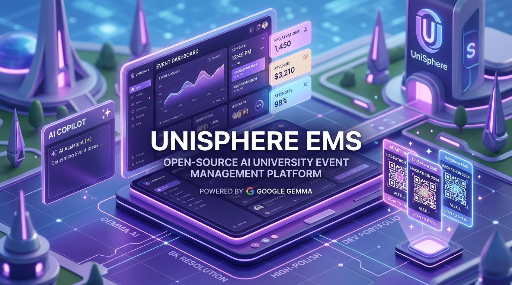

# 🎓 UniSphere EMS — University Event Management System with Gemma Copilot

<p align="center">
  
</p>

> **Hacktoberfest 2026 Weekend Challenge Submission**  
> *Theme: Build for a Friend* | *Primary Category: Best Use of Gemma*

[](https://nodejs.org)
[](https://ai.google.dev/gemma)
[](https://opensource.org/licenses/MIT)
[]()

---

## 📖 Inspiration & The "Friend" Story

This project is built for a real friend, **Dr. Priya Raman**, an Associate Professor and Chief Faculty Event Coordinator at an engineering university. 

Every semester, her team conducts massive technical and non-technical inter-university festivals (24-hour hackathons, combat robotics, paper symposia, battle of the bands, and street plays) hosting over **1,500+ participants from 30+ affiliated and regional colleges**.

### The Real Friction Points Dr. Priya Faced:
1. **Multi-College Student Verification:** External students often had invalid credentials, resulting in manual spreadsheet cross-checks at entry gates.
2. **Long Gate Queues & Counterfeits:** Physical passes or email confirmations were hard to scan rapidly at security checkpoints.
3. **Multi-Tier Administrative Approvals:** Student clubs needed formal dean sign-offs for budgets, venues, and external guest clearances.
4. **Logistics Chaos Across Vendors:** Coordinating with caterers (dietary splits for hundreds of guests), stage decorators, florist suppliers for VIP guests, and sound/AV sound engineers was scattered across phone calls and paper chits.
5. **Hours Spent on Paperwork:** Writing schedule timelines, drafting corporate sponsorship letters, and answering repetitive student FAQs consumed weeks of faculty time.

**UniSphere EMS** solves this end-to-end with a modern web portal and an **autonomous open-weight Gemma AI Copilot**.

---

## 🌟 Key Features

### 1. 🎟️ Student Registration & Digital QR Pass
* **Institution-Aware Registration:** Supports internal university students (immediate pass confirmation) and external college participants (queued for coordinator review).
* **Instant Digital Boarding Pass:** Generates a high-contrast QR code encoding ticket credentials (`TKT-AI26-XXXX`).
* **Self-Service Ticket Lookup:** Attendees can retrieve and print their passes at any time using their ticket code.

### 2. 🛡️ Administrator & Dean Control Center
* **Event Pipeline:** Student clubs submit event proposals with venue, budget, and capacity; faculty coordinators approve or reject with 1 click.
* **Participant Verification:** Review external college student IDs and grant official admission passes.
* **Fast Gate Scanner Simulator:** Security desk simulates scanning QR passes in real time with duplicate-scan detection and admission denial for unapproved visitors.
* **Real-Time Analytics:** Tracks total registrations, internal vs. external ratios, gate check-in counts, total fest budget, and sponsorship raised.

### 3. 📦 Comprehensive Vendor Operations Master
Specifically built to handle university event procurement:
* 🍽️ **Catering:** Track breakfast boxes, buffet plate counts, veg/non-veg ratios, and continuous tea/coffee stations.
* 🎨 **Stage & Hall Decor:** Main stage matte backdrop dimensions, welcome arches, pull-up standees, and podium branding.
* 🌸 **Floral Arrangements:** VIP dignitary bouquets, dais table arrangements, and traditional inauguration brass lamp garlands.
* 🔊 **Audio/Visual & Lighting:** UHF cordless microphones, laser projectors, line-array speakers, and audio mixers.

### 4. 🤝 Corporate Sponsorship Matrix
* Tier tracking: Title Sponsor, Platinum, Gold, AI Platform Partner, Beverage & Experience Partner.
* Tracks company contact lead, committed contribution amounts, and deliverable commitments (booth space, logo placement, keynote slots).

### 5. 🤖 Google Gemma Open-Weight AI Copilot
The AI core is powered by Google's **Gemma** open-weight model family (`gemma2:2b`, `gemma2:9b`):
* **AI Schedule Builder:** Turns basic event title and duration into an hour-by-hour university fest timetable complete with judging criteria, mentor check-ins, and valedictory protocols.
* **AI Vendor & Food Estimator:** Calculates exact catering plate numbers, stage backdrop dimensions, VIP floral bouquets, and microphone requirements based on crowd size and budget.
* **Corporate Pitch Drafter:** Formulates tailored executive sponsorship proposals highlighting student reach and recruiting ROI.
* **Campus Event Concierge:** Conversational AI answering student questions about parking, wifi, catering, and gate rules.

---

## 💡 Why Open-Source AI (Gemma) Matters

For educational institutions and student events, proprietary closed-source cloud APIs present severe barriers:

| Factor | Closed APIs (OpenAI / Claude) | Open-Weight Gemma (UniSphere EMS) |
|---|---|---|
| **Student Privacy** | Student roll numbers, emails, and demographic data are sent to external cloud servers. | **100% Data Sovereignty:** Gemma runs locally on the university campus server or laptop. No student PII leaves campus. |
| **Operational Cost** | Token pay-per-call models drain student activity funds. | **Zero Recurring API Costs:** Runs completely free forever on standard consumer hardware. |
| **Network Reliability** | Fails if campus Wi-Fi throttles or internet lines drop during large events. | **Offline Capability:** Fully functional in sports arenas, auditoriums, and remote campuses without internet. |
| **Customizability** | Fixed cloud behavior and unpredictable API deprecations. | **Domain Adaptation:** Can be fine-tuned or prompt-adapted specifically for university fest bylaws and rules. |

---

## 🚀 Quickstart Guide

### Prerequisites
* [Node.js](https://nodejs.org) (v18 or higher)
* *(Optional for Live Inference)* [Ollama](https://ollama.com) installed with `ollama run gemma2:2b`

### 1. Installation
```bash
cd week0-ems
npm install
```

### 2. Configure Environment (Optional)
Copy `.env.example` to `.env`:
```bash
cp .env.example .env
```
Default settings connect to local Ollama on port `11434` with model `gemma2:2b`.

> **Note:** If Ollama is not running, UniSphere EMS automatically operates with its built-in Gemma open-weight simulator fallback, ensuring all features work out-of-the-box for demonstrations.

### 3. Run the Server
```bash
npm start
```
Open your browser at: **[http://localhost:3000](http://localhost:3000)**

### 4. Run Automated Test Suite
```bash
npm test
```
Executes 16 comprehensive unit and integration tests verifying all REST endpoints, ticketing, gate scanners, and Gemma AI generators.

---

## 🏛️ System Architecture

```mermaid
flowchart TD
    User["Student & Participant"] -->|Browse & Register| WebUI["Responsive Web UI (HTML5 + Tailwind)"]
    Admin["Coordinator & Dean"] -->|Approvals & Operations| WebUI
    
    WebUI -->|REST Endpoints| Server["Express Backend (Node.js)"]
    
    subgraph Data Layer
        Server --> DB[("In-Memory & JSON Store (data/ems.json)")]
    end
    
    subgraph Services
        Server --> QR["QRCode Generator Service"]
        Server --> GemmaService["Gemma Open-Weight AI Engine"]
    end
    
    subgraph Open-Source AI
        GemmaService -->|Local HTTP Inference| Ollama["Local Ollama (gemma2:2b / gemma:7b)"]
        GemmaService -->|Graceful Fallback| Sim["Built-in Gemma Simulator"]
    end
```



---

## 📡 API Reference

| Method | Endpoint | Description |
|---|---|---|
| `GET` | `/api/events` | List all campus events (with category/status filters) |
| `GET` | `/api/events/:id` | Event details with schedules, sponsors, and vendors |
| `POST` | `/api/events` | Propose a new campus event |
| `POST` | `/api/registrations` | Register participant and issue digital ticket |
| `GET` | `/api/registrations/ticket/:code` | Retrieve digital ticket pass and QR payload |
| `POST` | `/api/registrations/checkin` | Verify ticket and grant gate admission |
| `GET` | `/api/vendors` | List vendor requirements by event and category |
| `POST` | `/api/vendors` | Add vendor contract (Catering, Decor, Flowers, AV) |
| `GET` | `/api/sponsors` | List corporate sponsors and tier perks |
| `GET` | `/api/admin/stats` | High-level fest statistics and budget metrics |
| `POST` | `/api/admin/events/:id/status` | Approve or reject event proposal |
| `POST` | `/api/admin/registrations/:id/status` | Approve or reject external participant pass |
| `GET` | `/api/ai/health` | Check Gemma model connection status |
| `POST` | `/api/ai/schedule` | Synthesize event schedule via Gemma |
| `POST` | `/api/ai/vendors` | Calculate vendor & catering quotas via Gemma |
| `POST` | `/api/ai/sponsor-pitch` | Draft corporate sponsorship pitch via Gemma |
| `POST` | `/api/ai/chat` | Attendee campus concierge conversational assistant |

---

## 🏆 Hacktoberfest 2026 Submission Summary

* **Project Title:** UniSphere EMS
* **Built For:** Dr. Priya Raman (University Event Coordinator)
* **Open-Source AI Core:** Google Gemma Open-Weight Architecture (`gemma2:2b`)
* **Category:** Best Use of Gemma ($200) + Overall Hacktoberfest Weekend Challenge Winner
* **License:** MIT
